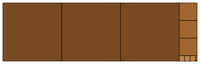

<p align="center">
  
</p>

<h1 align="center">bronze.css</h1>

<p align="center">
  Utility CSS in which <b>every measure is a power of the bronze ratio</b>.<br>
  Spacing, font sizes, columns, aspect ratios and breakpoints all follow one single number.
</p>

<p align="center">
  <a href="https://github.com/mistervoga/bronze.css/stargazers"></a>
  <a href="LICENSE"></a>
  
  
  
  
  
</p>

<p align="center">
  <a href="#quick-start-60-seconds">Quick start</a> ·
  <a href="#step-by-step">Step by step</a> ·
  <a href="#classes">Classes</a> ·
  <a href="#building-it-yourself">Build it yourself</a> ·
  <a href="#troubleshooting">Troubleshooting</a> ·
  <a href="#license">License</a>
</p>

---

```
B = (3 + √13) / 2 = 3.302776…        B² = 3B + 1        B = 3 + 1/B
```

The logo shows the core idea. A rectangle with ratio B : 1 splits into **three squares and a remainder**, and the remainder has ratio B : 1 again. That follows from B = 3 + 1/B.

## What you need

| You want to … | You need |
|---|---|
| **use bronze.css** | only the file `bronze.css` and a browser. No Go, no Node, no build tool. |
| look at the demo | `index.html` and `bronze.css` in the same folder |
| **change and regenerate** the framework | [Go](https://go.dev/dl/) 1.21 or newer as well |

**Browser support:** current Chrome, Edge, Firefox and Safari. The minimum versions are Chrome/Edge 108, Firefox 101 and Safari 15.4, because of `dvh`, `aspect-ratio` and `gap`.

## Quick start (60 seconds)

1. **Download `bronze.css`** and put it in your project folder.
2. **Link it in the `<head>` of your HTML file:**

   ```html
   <link rel="stylesheet" href="bronze.css">
   ```

3. **Use the classes:**

   ```html
   <main class="container flow-3 py-4">
     <h1>Hello</h1>
     <p class="text-lg text-ink-2 measure">Everything in the bronze ratio.</p>
   </main>
   ```

Done.

## Step by step

### Step 1: Get the files

Pick **one** of the three options.

**a) Without Git: download the ZIP (easiest)**

1. On GitHub, click the green **Code** button, then **Download ZIP**.
2. Extract the ZIP file:

| System | How |
|---|---|
| Windows | Right-click the ZIP file, **Extract All…**, then **Extract** |
| macOS | Double-click the ZIP file |
| Linux | Right-click, **Extract Here**, or in a terminal `unzip bronze.css-main.zip` |

**b) With Git**

Open a terminal:

| System | Terminal |
|---|---|
| Windows | Start menu, type "Terminal" or "PowerShell", press Enter |
| macOS | `Cmd + Space`, type "Terminal", press Enter |
| Linux | usually `Ctrl + Alt + T` |

Then run:

```sh
git clone https://github.com/mistervoga/bronze.css.git
cd bronze.css
```

If Git is not installed, you get `git: command not found`. Install it:

| System | Command |
|---|---|
| Windows | `winget install --id Git.Git -e`, then reopen the terminal |
| macOS | `xcode-select --install` or `brew install git` |
| Debian/Ubuntu | `sudo apt install git` |
| Fedora | `sudo dnf install git` |
| Arch | `sudo pacman -S git` |

**c) Just the one file**

Open `bronze.css` in the repo, click **Raw** and save it with **Ctrl + S** (on a Mac **Cmd + S**). Make sure the file is really named `bronze.css` and not `bronze.css.txt`.

### Step 2: Open the demo (optional)

Double-click `index.html`. It runs straight in the browser; no server is needed. The demo shows every spacing step, font size, grid and aspect ratio.

### Step 3: Add it to your project

**Plain HTML page.** Put `bronze.css` next to your HTML file:

```
my-project/
├── index.html
└── bronze.css
```

```html
<!doctype html>
<html lang="en">
<head>
  <meta charset="utf-8">
  <meta name="viewport" content="width=device-width, initial-scale=1">
  <title>My page</title>
  <link rel="stylesheet" href="bronze.css">
</head>
<body>
  <main class="container flow-4 py-4">
    <h1>My page</h1>
    <section class="cols-1 md:cols-b1 gap-4">
      <article class="stack-2">
        <h2>Content</h2>
        <p class="text-ink-2">Wide column: (B − 1) parts.</p>
      </article>
      <aside class="border-l pl-3 text-sm text-muted">Narrow column: 1 part.</aside>
    </section>
  </main>
</body>
</html>
```

> **If the CSS file is in a subfolder**, the path must match, e.g. `href="css/bronze.css"`. Upper and lower case matter on Linux and on web servers.

**With a build tool** (Vite, React, Vue, Svelte, Astro, …). Copy `bronze.css` into e.g. `src/` and import it once at the top of your entry file:

```js
// src/main.js, src/main.jsx, src/main.ts …
import "./bronze.css";
```

In React the attribute is `className` instead of `class`:

```jsx
<main className="container flow-3 py-4">…</main>
```

**Together with Tailwind or Bootstrap** is not recommended. Class names such as `container`, `flex` and `p-2` collide, and whichever file loads last wins.

### Step 4: Check that it works

Open the page. The background must be **light beige** (`#eeeae5`), or **almost black** with a dark system theme. If it is white, the CSS file was not found; see [Troubleshooting](#troubleshooting).

## How the scale works

The only freely chosen number is the base unit **u = 0.5625 rem = 9 px**.

### Spacing: u·B<sup>n−2</sup>

| Step `N` | Factor | px |
|---|---|---|
| `0` | 0 | 0 |
| `1` | u / B | 2.7 |
| `1.5` | u / √B | 5.0 |
| `2` | u | 9.0 |
| `2.5` | u·√B | 16.4 |
| `3` | u·B | 29.7 |
| `3.5` | u·B·√B | 54.0 |
| `4` | u·B² | 98.2 |
| `4.5` | u·B²·√B | 178.4 |
| `5` | u·B³ | 324.2 |

- Whole steps are a factor of **B** apart, half steps a factor of **√B**.
- **Strictly bronze** means: use whole steps only.

### Type: 1 rem·B<sup>k/4</sup>

| Class | Size | px |
|---|---|---|
| `text-xs` | B<sup>−½</sup> rem | 8.8 (superscripts and footnotes only) |
| `text-sm` | B<sup>−¼</sup> rem | 11.9 |
| `text-base` | 1 rem | 16 |
| `text-lg` | B<sup>¼</sup> rem | 21.6 |
| `text-xl` | B<sup>½</sup> rem | 29.1 |
| `text-2xl` | B<sup>¾</sup> rem | 39.2 |
| `text-3xl` | B rem | 52.8 |

Line heights: `leading-tight` B<sup>¼</sup> ≈ 1.35, `leading-normal` B<sup>⅓</sup> ≈ 1.49 (default), `leading-loose` B<sup>½</sup> ≈ 1.82.

### Breakpoints

| Prefix | applies from | Origin |
|---|---|---|
| (none) | always | – |
| `md:` | 36.83 rem ≈ 589 px | u·B<sup>3.5</sup> |
| `lg:` | 66.93 rem ≈ 1071 px | u·B<sup>4</sup> |

It is **mobile first**. `class="cols-1 md:cols-2 lg:cols-b3"` gives one column on a phone, two on a tablet, and three in the ratio (B−1) : 1 : 1 on a desktop.

## Classes

`N` is a step from the spacing table: `0 1 1.5 2 2.5 3 3.5 4 4.5 5`. In HTML you write the dot as is, e.g. `class="p-2.5"`.

| Group | Classes | Example |
|---|---|---|
| Margin | `m-N mt-N mr-N mb-N ml-N mx-N my-N`, `m-auto mx-auto …` | `mt-3` |
| Padding | `p-N pt-N pr-N pb-N pl-N px-N py-N` | `px-2.5 py-2` |
| Gaps | `gap-N gap-x-N gap-y-N` | `gap-3` |
| **Building blocks** | `stack-N`: column with gap. `cluster-N`: wrapping row. `flow-N`: space between siblings. `container`: centred, max ≈ 1071 px. `measure`: comfortable line length. | `stack-2` |
| Display | `block inline inline-block flex inline-flex grid contents hidden` | `md:hidden` |
| Flex | `flex-row flex-col flex-wrap flex-1 flex-none grow`, `items-*` and `self-*` (start center end baseline stretch), `justify-*` (start center end between around) | `flex items-center justify-between` |
| Grid | `cols-1 … cols-6`, `span-1 … span-6`, `span-full`, `auto-fill`. Every `cols-*` class is a grid by itself. | `cols-3 gap-2` |
| **Bronze grids** | `cols-b` B : 1, `cols-b-rev` 1 : B, `cols-b1` (B−1) : 1, `cols-b1-rev`, `cols-b3` (B−1) : 1 : 1, `cols-3b` 1 : 1 : 1 : 1/B | `cols-b1 gap-4` |
| Width | `w-full w-auto`, `w-major` (B−1)/B, `w-minor` 1/B, `w-minor-2` 1/B² | `w-minor` |
| Height | `h-full h-screen min-h-screen min-h-0 min-w-0` | `min-h-screen` |
| Max width | `max-w-measure max-w-container max-w-none` | `max-w-measure` |
| Aspect ratio | `aspect-b` B : 1, `aspect-b1` (B−1) : 1, `aspect-sqrt-b` √B : 1, `aspect-square` | `aspect-b1` |
| Text | `text-xs … text-3xl`, `leading-*`, `text-left text-center text-right`, `font-normal font-bold font-mono font-sans`, `uppercase truncate nowrap tabular` | `text-sm font-mono` |
| Position | `static relative absolute sticky top-0`, `overflow-auto overflow-hidden` | `sticky top-0` |
| Colour | `text-ink text-ink-2 text-muted text-accent text-page text-line`, plus `bg-…` with the same names | `bg-accent text-page` |
| Border | `border border-t border-r border-b border-l border-0 border-accent`, `rounded-0 rounded-1 rounded-2 rounded-full` | `border-t pt-3` |
| Other | `underline no-underline sr-only` | `sr-only` |

The `md:` and `lg:` prefixes exist for every layout, spacing, size and text class. Colours and borders have no prefixes.

### Common patterns

```html
<!-- Page with a sidebar, stacked on phones -->
<div class="container cols-1 lg:cols-b1 gap-4 py-4">
  <main class="flow-3">…</main>
  <aside class="border-l pl-3">…</aside>
</div>

<!-- Button row -->
<div class="cluster-2">
  <button class="border rounded-1 px-2.5 py-1">Cancel</button>
  <button class="bg-accent text-page rounded-1 px-2.5 py-1 border-0">Save</button>
</div>

<!-- Card with an image in ratio (B − 1) : 1 -->
<article class="stack-2">
  
  <h3>Title</h3>
  <p class="text-sm text-ink-2">Text</p>
</article>
```

## Customising without regenerating

Every value is a CSS variable. Override them **after** linking bronze.css, in your own CSS file:

```css
:root {
  --u: 0.625rem;        /* everything slightly larger: u = 10 px */
  --accent: #6b3e1f;    /* your own accent colour */
  --sans: "Inter", system-ui, sans-serif;
}
```

- **Dark theme:** it follows the system setting automatically.
  - Always dark: `<html data-theme="dark">`.
  - Always light: `<html data-theme="light">`.
- **Breakpoints:** they stay at u = 9 px even if you change `--u`. Media queries cannot read CSS variables.

## Building it yourself

`bronze.css` is written by a small Go program, `gen/main.go`. You **only** need this to add classes or change the scale.

### 1. Install Go (1.21 or newer)

| System | Command or method |
|---|---|
| Windows | `winget install --id GoLang.Go -e`, or the installer from [go.dev/dl](https://go.dev/dl/). Then **reopen the terminal**. |
| macOS | `brew install go`, or the `.pkg` from [go.dev/dl](https://go.dev/dl/) |
| Debian/Ubuntu | `sudo apt install golang-go`. If the version is too old (check with `go version`), use the archive from [go.dev/dl](https://go.dev/dl/). |
| Fedora | `sudo dnf install golang` |
| Arch | `sudo pacman -S go` |

Check:

```sh
go version
```

The output should look like `go version go1.22.x …`, or a newer version.

### 2. Generate, inside the `bronze.css` folder

```sh
go run ./gen -o bronze.css
```

The output is `bronze.css v1.0.0 written: bronze.css`. The command works the same in PowerShell, cmd, the macOS Terminal and Linux shells.

> **Windows pitfall avoided:** use `-o bronze.css` and **not** `go run ./gen > bronze.css`. Windows PowerShell 5.1 saves `>` output as UTF-16, and the browser cannot read the file.

### 3. Run the tests

```sh
go test ./...
```

The output `ok  bronzecss/gen` means everything is fine. The tests check:

- the derivation of B,
- that each spacing step is exactly √B larger than the previous one,
- that no class is defined twice,
- that the CSS braces are balanced.

### Project layout

```
bronze.css/
├── bronze.css        ← the framework (generated, do not edit by hand)
├── index.html        ← demo
├── logo.svg          ← logo
├── gen/
│   ├── main.go       ← generator: derivation of B and all classes
│   └── main_test.go  ← tests
├── go.mod
├── LICENSE           ← MIT
└── README.md
```

## Where does B come from?

- **Source:** a handwritten manuscript ("Paper 1") on the **Hurwitz continued fraction**

  h(a, n) = a + 1 / (a(1+n) + 1 / (a(1+2n) + …))

- **Convergents:** the manuscript gives a closed form for the p-th convergent H<sub>p</sub>(a, n). The generator evaluates it with exact fractions; `math/big` is enough for that.
- **Bronze ratio:** for n = 0, h(a, 0) = [a; a, a, …] = (a + √(a² + 4)) / 2.
  - a = 1 is the golden ratio (1.618…).
  - a = 2 is the silver ratio (2.414…).
  - **a = 3 is the bronze ratio (3.302…).**
- **No √13 in the code:** B is taken from the convergents 3, 10/3, 33/10, 109/33, 360/109, … until two of them differ by less than 10⁻¹³.

## Troubleshooting

| Problem | Cause and fix |
|---|---|
| Page is white, classes have no effect | The path in `<link href="…">` is wrong. Open the developer tools (**F12**, on a Mac **Cmd + Option + I**), tab **Network** or **Console**: if `bronze.css` shows `404`, fix the path. |
| File is named `bronze.css.txt` | Windows hides file extensions. In Explorer, enable **View → Show → File name extensions** and rename it. |
| Changes do not show up | Browser cache. Reload with **Ctrl + F5**, on a Mac **Cmd + Shift + R**. |
| `go: command not found`, or "The term 'go' is not recognized" | Go is not installed, or the terminal was not reopened after installing. Close the terminal, open it again, run `go version`. |
| `go.mod requires go >= 1.21` | Your Go is too old. Install a newer version from [go.dev/dl](https://go.dev/dl/). |
| Generated file contains strange characters | It was created with `>` in Windows PowerShell 5.1. Regenerate with `go run ./gen -o bronze.css`. |
| `p-2.5` has no effect | In HTML the dot is written as is: `class="p-2.5"`. Only in **your own** CSS does it need escaping: `.p-2\.5`. |
| Two columns do not appear side by side | Prefixes only apply from a certain width. `md:cols-2` takes effect from ≈ 589 px. Either the window is narrower, or an unprefixed class like `cols-1` is missing. |
| Conflict with Tailwind/Bootstrap | Same class names. Use only one utility framework per page. |

## Contributing

1. Fork the repo and create a branch: `git checkout -b my-change`.
2. Change only `gen/main.go`, **never** `bronze.css` by hand.
3. Run `go run ./gen -o bronze.css` and `go test ./...`.
4. Commit `bronze.css` too and open a pull request.

If you like the project, give it a ⭐ on GitHub.

## License

[MIT](LICENSE) © 2026 Nicolas von Garrel. You may use, modify and redistribute bronze.css freely, including commercially. The license notice must be kept.
